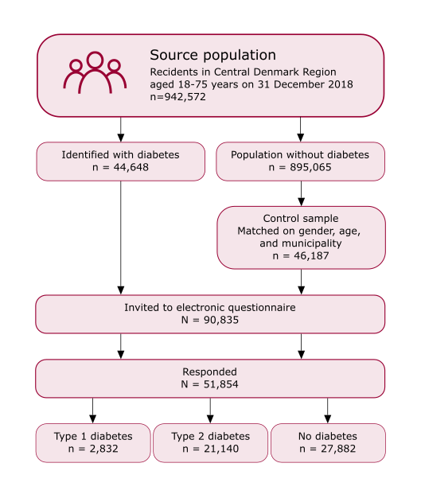

## Purpose
The aim of the Health in Central Denmark cohort (HICD) is to improve understanding of the health and disease burden among people with diabetes and other chronic diseases. The cohort will be followed over a ten-year period using questionnaire and register data to examine the development of disease and diabetes-related complications.

## About 
The HICD cohort was initiated in 2020 by Steno Diabetes Center Aarhus as a population-based research resource in the Central Denmark Region. The baseline survey was conducted between November 2020 and February 2021 and included approximately 90,000 adults with and without diabetes identified through national registers. In 2024, the cohort was expanded through a second large-scale questionnaire survey including approximately 130,000 individuals from the region. 

HICD combines repeated questionnaire data with linkage to Danish nationwide health, laboratory, and administrative registers, enabling longitudinal studies of chronic disease burden, diabetes-related complications, healthcare utilisation, and social inequalities in health. Follow-up is planned for at least 10 years, with repeated questionnaire waves every 4 years and updates of registry and laboratory data every second year.

## Population
All inhabitants of the Central Denmark Region aged 18–75 years on 31 December 2018 were identified through the Danish Civil Registration System (n = 942,572). Persons with diabetes were identified from this population using national Danish registers. Diabetes was identified based on hospital diagnoses (ICD-10 codes DE10–DE14) recorded in the Danish National Patient Register, redeemed glucose-lowering medications recorded in the Danish National Prescription Registry (ATC code A10, excluding Saxenda), diabetes-specific podiatry services recorded in the Danish National Health Service Register, and HbA1c measurements (≥48 mmol/mol) recorded in the Clinical Laboratory Information System in the Central Denmark Region (LABKA II; NPU27300 and NPU03835) (see Register data).

In total, 44,648 persons with diabetes were identified. From the remaining population in the Central Denmark Region (n = 895,065), a comparison group without diabetes (n = 46,187) was selected using simple random sampling among individuals meeting the matching criteria of sex, age and municipality.

An electronic questionnaire was distributed to eligible members of the cohort on 18 November 2020, and data collection ended on 7 February 2021. In total, 51,854 persons responded to the questionnaire (57.1% of those invited). Among persons with type 1 diabetes, 2,832 (55.9%) responded; among those with type 2 diabetes, 21,140 (53.2%) responded; and among those without diabetes, 27,882 (60.4%) responded.

## Follow-up

The HICD cohort is followed through repeated questionnaires and linkage to national and regional registers. The first follow-up questionnaire was conducted in 2024, and the next is planned for 2028. All individuals invited at baseline will be invited to participate in subsequent questionnaire waves, regardless of whether they responded to previous questionnaires.

The cohort follows an open-cohort design, allowing new individuals to be included at each follow-up. This includes individuals who have developed diabetes since the previous wave, reached the age of 18 years or moved into the Central Denmark Region. For newly identified individuals with diabetes, a comparison group without diabetes is selected using the same approach as at baseline, based on sex, age and municipality.

Register and laboratory data are updated yearly.

## Terms of use
All users need an affiliation (not necessarily paid emploument) with Steno Diabetes Center Aarhus to obtain direct acces and need to have an active access to Statistics Denmark"

## Contact
* Kasper Norman ([kanoan\@rm.dk](mailto:kanoan@rm.dk))
* Theresa Møller Kynde ([therad\@rm.dk](mailto:therad@rm.dk))

